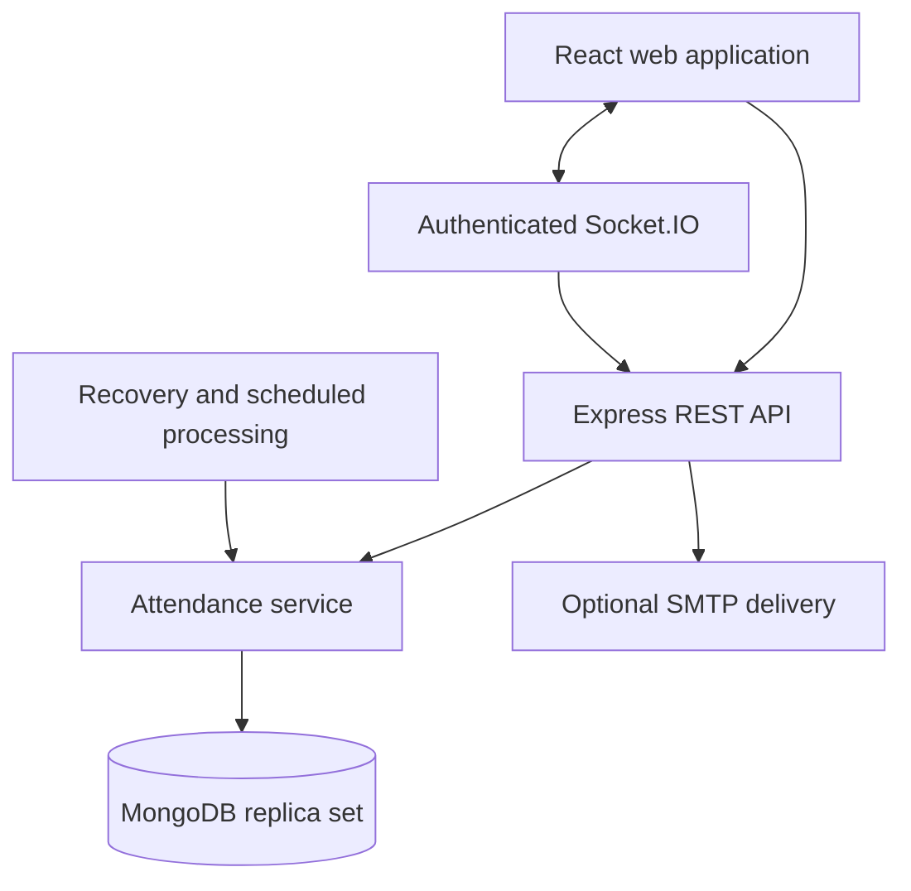

# Architecture and business rules

## Components

React never connects directly to MongoDB. The Node backend owns identity, roles, enrollment rules, expiry and all writes. The production Express server also serves compiled frontend assets. Socket events invalidate cached session data; they do not expose entire student lists. REST authorization is rechecked on each data refresh.

## Source layout

| Path                              | Responsibility                                                      |
| --------------------------------- | ------------------------------------------------------------------- |
| backend/src/config.js             | Environment loading and startup validation                          |
| backend/src/models.js             | Mongoose schemas and indexes                                        |
| backend/src/security.js           | Token signing, verification and authorization middleware            |
| backend/src/auth-routes.js        | Login, refresh, logout, change and reset passwords                  |
| backend/src/data-routes.js        | People, academics, enrollments, timetable, settings and audit       |
| backend/src/attendance.js         | Transactions, scan, finalization, correction, statistics and worker |
| backend/src/app.js                | HTTP middleware, attendance endpoints, reports and static files     |
| backend/src/server.js             | Startup, WebSocket authorization, scheduler and shutdown            |
| backend/src/bootstrap.js          | One-time initial administrator                                      |
| backend/src/fixtures.js / seed.js | Explicit synthetic sample data                                      |
| backend/test                      | Security/policy and MongoDB integration suites                      |
| frontend/src/main.jsx             | Role-based screens and shared UI components                         |
| frontend/src/api.js               | In-memory access token, refresh coordination and HTTP calls         |
| frontend/src/styles.css           | Responsive design system                                            |

## Data model

Departments contain classes and subjects. Teaching assignments connect class, subject and faculty. Enrollments link students to assignments. Each session stores its original faculty, subject, class, eligible roster and attendance policy. Attendance records reference the session and student. Audit entries record relevant mutations. Refresh and reset tokens have expiry indexes and store only hashes.

Unique indexes enforce user email/code, subject/department code, subject–class assignment, student–assignment enrollment, and session–student attendance. A partial unique index prevents two active sessions for the same teaching assignment.

## Atomic attendance writes

Every QR submission validates the server signature and expiry. Inside a MongoDB transaction it checks eligibility and session state, reads any existing mark, updates the session revision and inserts attendance. Finalization also writes that session document and creates missing absences in its transaction. Concurrent scan/finalize operations therefore conflict on the same document rather than independently creating inconsistent outcomes; MongoDB transaction retries arbitrate the conflict.

A repeated valid scan returns the existing record. An unmarked student cannot create a new record after expiry or close. An already-marked student may retrieve their idempotent result while the QR itself remains valid. Cancelled sessions are excluded from reports. Active sessions can be cancelled with a reason; completed sessions can be corrected with an audit record.

## Attendance formula

Count only completed, non-cancelled sessions represented by an attendance record. An excused record is excluded from the denominator. Present counts as attended. Late counts according to the policy snapshot saved at the start of that session. All-excused or empty histories show no percentage, rather than a misleading zero.

A manual correction and its audit entry commit in the same transaction. Historical rosters are not reconstructed from current enrollment, so a student transfer does not rewrite old class lists.

## Background behavior

A 30-second sweep finalizes overdue active sessions, including sessions left open before a restart. An hourly evaluation creates daily-deduplicated in-app shortage notifications. The application instance performs this work; a separate externally provisioned task scheduler is not required for this single-instance release.

## Security properties and limits

- Password hashing uses bcrypt with cost 12 and a 72-byte maximum.
- Access JWTs last 15 minutes, use an explicit algorithm/issuer/audience and include a revocation version.
- Refresh tokens are randomly generated, stored hashed and rotated on use.
- User status/version is checked on authenticated requests. Logout, password change and admin updates revoke credentials.
- Recovery tokens are random, stored hashed, time limited and single use.
- QR and account tokens have separate keys and audiences.
- Request schemas reject unexpected fields for administrative resources.
- Role boundaries and object ownership are enforced server-side.
- No long-lived credentials are stored in browser localStorage.
- Student identity is derived from authentication, never a studentId submitted to the scan endpoint.
- Timetable overlap checks prevent normal conflicting edits; administrative schedule editing should remain a low-concurrency operation.
- Dynamic QR codes reduce stale replay, but real-time forwarding and account sharing remain possible. Physical attendance disputes still need institutional procedures.

## Engineering references

- MongoDB transactions: https://www.mongodb.com/docs/manual/core/transactions/
- MongoDB unique indexes: https://www.mongodb.com/docs/manual/core/index-unique/
- Socket.IO authorization middleware: https://socket.io/docs/v4/middlewares/
- Socket.IO room and multi-server behavior: https://socket.io/docs/v4/rooms/
- Nodemailer SMTP: https://nodemailer.com/smtp
- UUID advisory and patch: https://github.com/uuidjs/uuid/security/advisories/GHSA-w5hq-g745-h8pq
